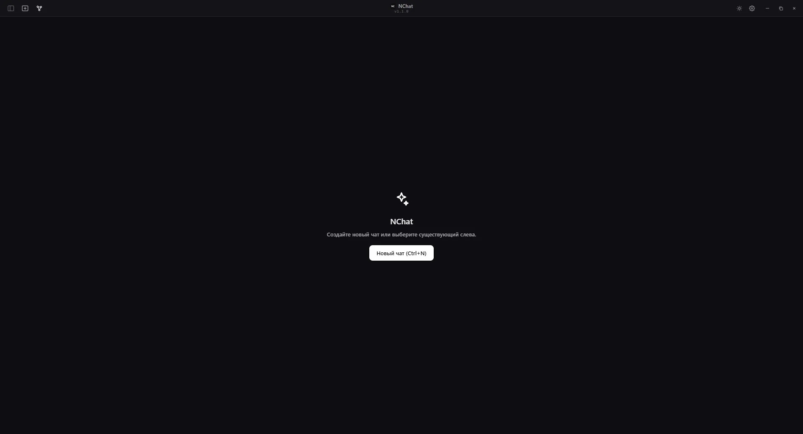
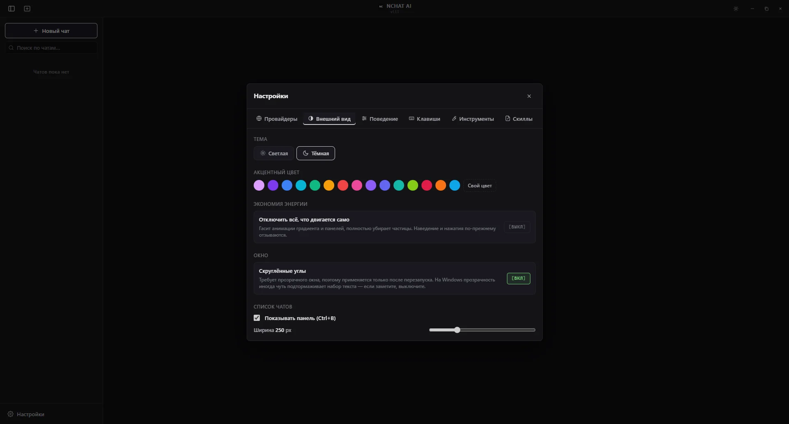

# NChat (NeuralChat) — бесплатный ИИ-чат для Windows

**NChat** (NeuralChat) — бесплатное настольное приложение для Windows для работы с языковыми моделями. ИИ-агент с доступом к вашему компьютеру: файлы, командная строка, git, MCP-серверы и несколько чатов одновременно — в одном окне.

🌐 **Сайт:** https://uzuqween.github.io/nchat-site/
⬇️ **Скачать для Windows:** [NChat.exe](https://github.com/uzuqween/nchat-site/releases/latest/download/NChat.exe) · [все релизы](https://github.com/uzuqween/nchat-site/releases)
💬 **Telegram:** https://t.me/NChat_AI
❓ **FAQ:** https://uzuqween.github.io/nchat-site/faq.html

## Возможности

- **Работа с файлами** — чтение, поиск по имени и содержимому, правка фрагментов, создание, копирование и перемещение прямо из чата.
- **Оболочка и система** — выполнение команд, запуск программ, процессы, службы и переменные среды под контролем подтверждений.
- **Git** — статус, диффы, история, коммиты, ветки, push и pull без переключения на терминал.
- **MCP-серверы** — подключение внешних инструментов по протоколу Model Context Protocol. Состав инструментов зависит от подключённых серверов.
- **Несколько чатов сразу** — параллельные диалоги с индикатором состояния каждого запроса.
- **Артефакты-превью** — HTML, SVG и Mermaid-диаграммы из ответа модели рисуются рядом с кодом.

## Под вашим контролем

- **Вы подтверждаете** — инструменты, которые пишут файлы или запускают процессы, сначала спрашивают разрешения.
- **Граница проекта** — запись за пределы папки проекта подтверждается всегда, без исключений.
- **Видно каждый шаг** — статусы «готово», «думает», «ошибка» показывают, что модель делает прямо сейчас.
- **Ничего втихую** — если нужной утилиты нет, NChat покажет команду установки, а не поставит её сам.

## Установка и обновление

1. Скачайте [NChat.exe](https://github.com/uzuqween/nchat-site/releases/latest/download/NChat.exe).
2. Запустите его — это портативная сборка, установка не требуется.
3. Обновления NChat проверяет сам через GitHub Releases (с версии 1.1.0) и сверяет SHA-256 файла.

**Требования:** Windows 10 и новее, x64, Microsoft Edge WebView2 Runtime (в Windows 11 уже встроен).

**Данные:** чаты и настройки хранятся локально в `%APPDATA%\nchat`.

---

**English:** NChat (NeuralChat) is a free desktop AI chat app for Windows — an AI agent with access to your files, shell, git and MCP servers, with multiple parallel chats. Website: https://uzuqween.github.io/nchat-site/
