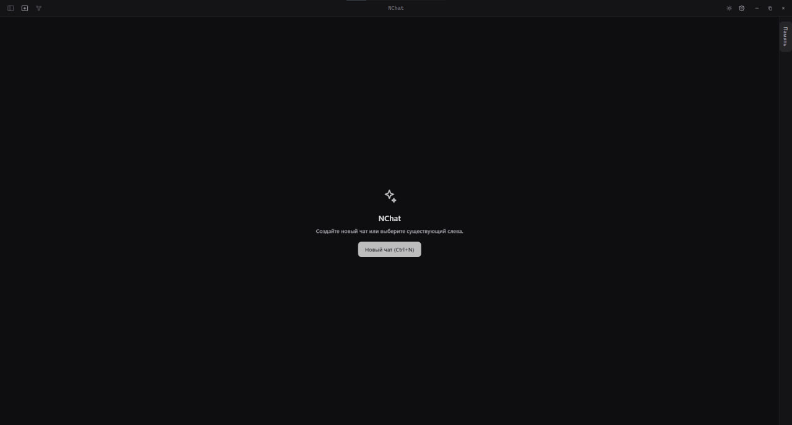
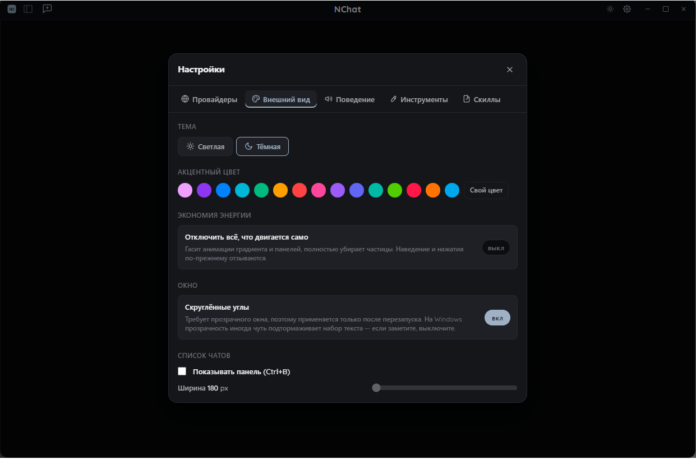

# NChat (NeuralChat) — бесплатный ИИ-чат для Windows

**NChat** (NeuralChat) — бесплатное настольное приложение для Windows для работы с языковыми моделями. ИИ-агент с доступом к вашему компьютеру: файлы, командная строка, git, MCP-серверы и несколько чатов одновременно — в одном окне.

🌐 **Сайт:** https://uzuqween.github.io/nchat-site/
⬇️ **Скачать для Windows:** [NChat.exe](https://github.com/uzuqween/nchat-site/releases/latest/download/NChat.exe) · [все релизы](https://github.com/uzuqween/nchat-site/releases)
💬 **Telegram:** https://t.me/NChat_AI
❓ **FAQ:** https://uzuqween.github.io/nchat-site/faq.html

## Возможности

- **Работа с файлами** — чтение, создание и правка файлов в папке проекта.
- **Оболочка и система** — выполнение команд в терминале.
- **Git** — коммиты, ветки и история прямо из чата.
- **MCP-серверы** — подключение инструментов по протоколу Model Context Protocol.
- **Несколько чатов сразу** — параллельные диалоги с разными задачами.
- **Артефакты-превью** — просмотр результатов (страниц, кода) прямо в приложении.

## Под вашим контролем

- **Вы подтверждаете** важные действия агента.
- **Граница проекта** — агент работает только в выбранной папке.
- **Видно каждый шаг** — все вызовы инструментов показаны в чате.
- **Ничего втихую** — никаких скрытых действий.

## Установка

1. Скачайте [NChat.exe](https://github.com/uzuqween/nchat-site/releases/latest/download/NChat.exe).
2. Запустите его — это портативная сборка, установка не требуется (Windows 10 и новее, x64).

---

**English:** NChat (NeuralChat) is a free desktop AI chat app for Windows — an AI agent with access to your files, shell, git and MCP servers, with multiple parallel chats. Website: https://uzuqween.github.io/nchat-site/
